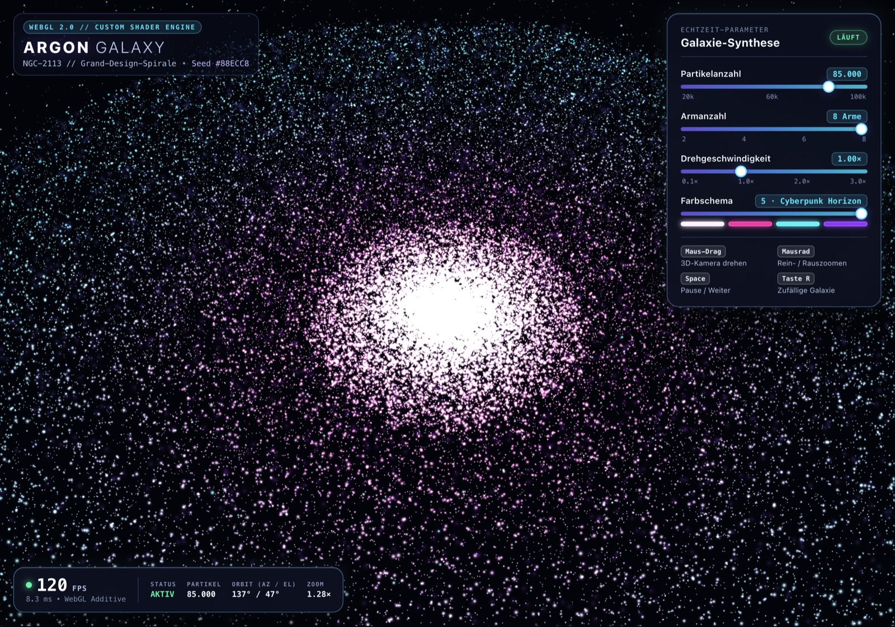
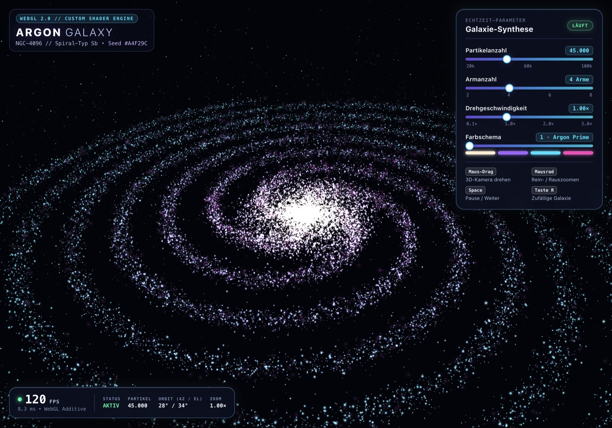
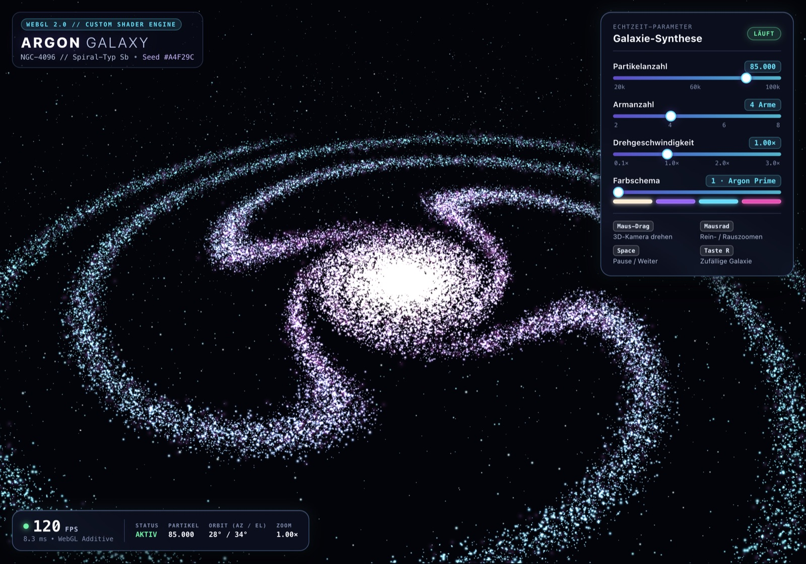
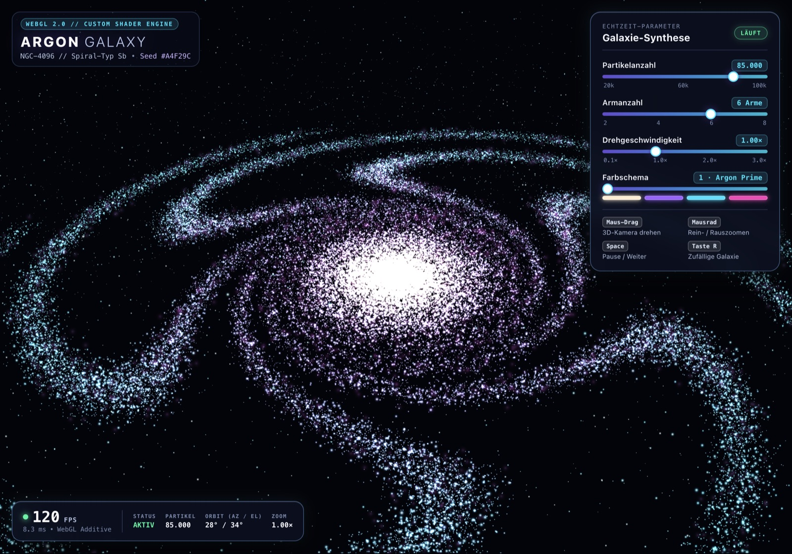
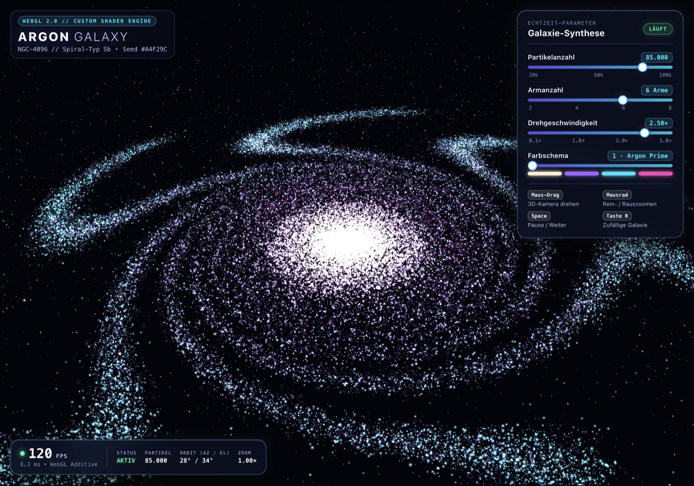
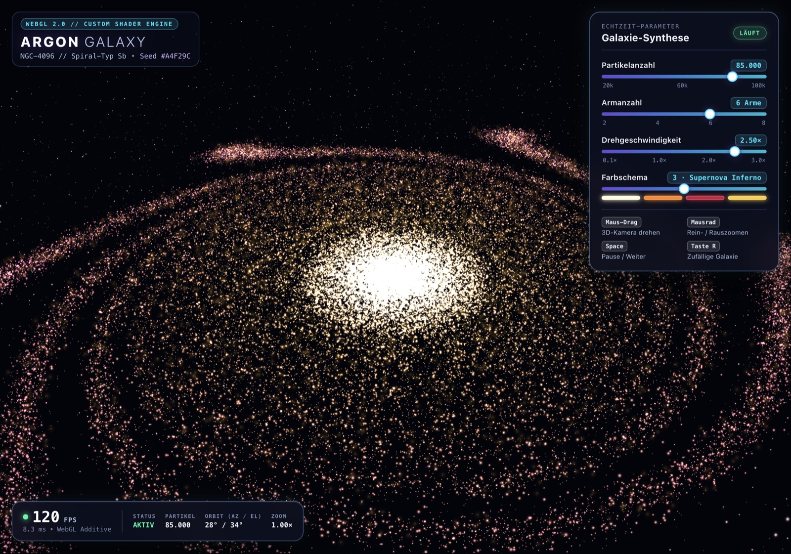
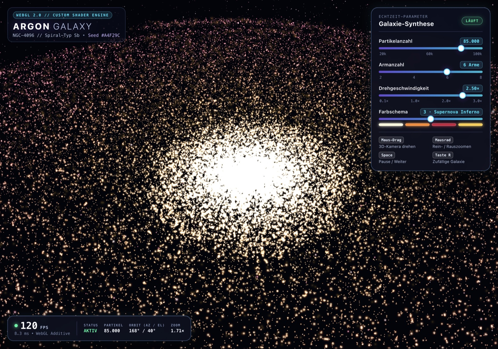
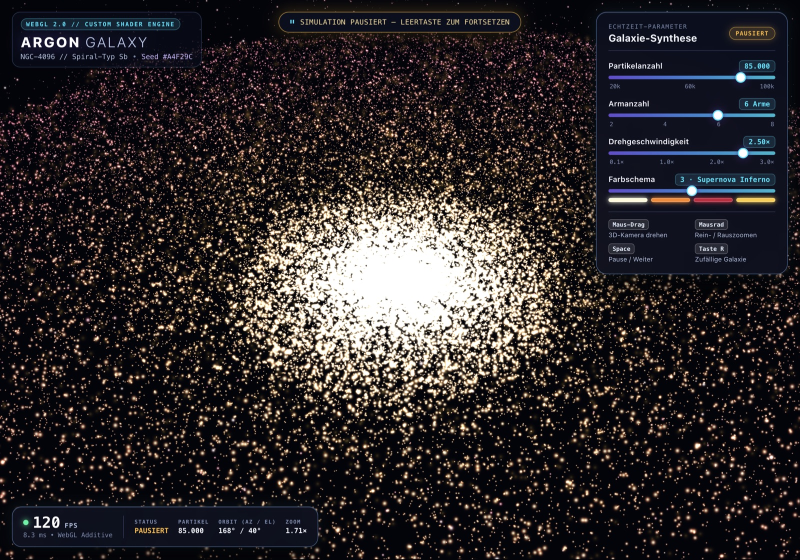
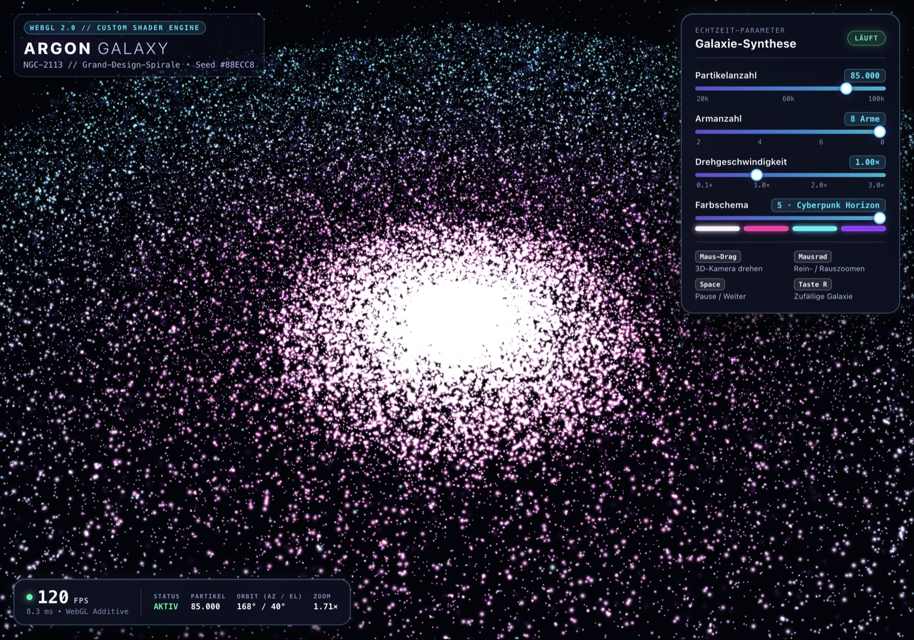

# ARGON Galaxy

Interactive 3D particle spiral galaxy in plain HTML, CSS and JavaScript (WebGL 2, no frameworks).

Built from a single prompt by **Gemini 4 Argon** in the **Cursor** desktop app. The agent wrote the code, started a local server, opened the page in Chrome via computer use, tested every slider and key, took the screenshots below and fixed issues on its own.



## Run

```bash
python3 -m http.server 8765
# open http://127.0.0.1:8765
```

## Controls

- Mouse drag: rotate
- Mouse wheel: zoom
- Space: pause
- R: new random galaxy
- Panel: particles, arms, rotation speed, color scheme (live)

## Prompt

See [PROMPT.md](PROMPT.md).

## Agent test screenshots

| | |
|---|---|
|  |  |
|  |  |
|  |  |
|  |  |

Made by [@tayyare1](https://x.com/tayyare1). MIT License.
